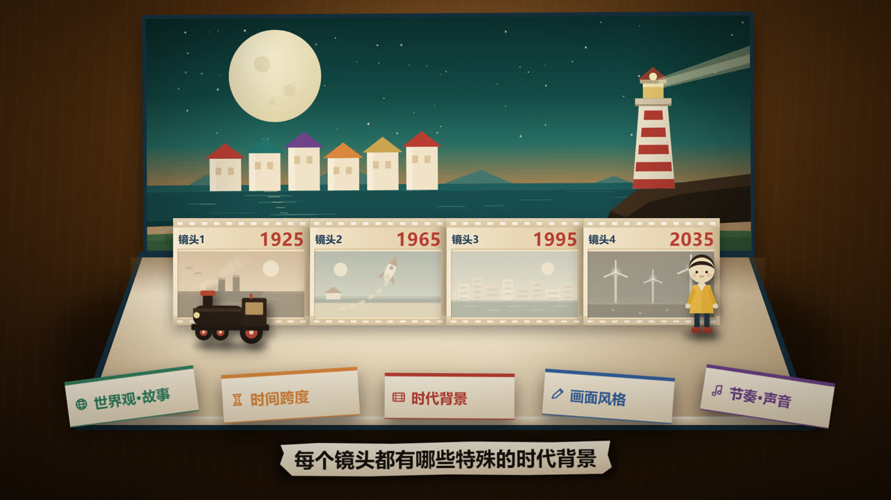

# 立体书 · 约束越多，作品越能脱颖而出 — Remotion 复刻

用 [Remotion](https://www.remotion.dev/) 复刻 M OTIONFACE 动效片段
`ad1b3f0a-1770-4743-a28f-9a7ad9c378af`《立体书：约束越多，作品越能脱颖而出》的纸质定格动画。

复刻对象是一支 38.2 秒、1920×1080、30fps 的中文说明动画：暖光木桌上的纸质立体书，
通过 OMNI 提示词机器、我与 Gemini 的对话、五个约束维度页签、四个时代的时间轴手风琴、
以及"平均水平 ≠ 约束后的作品"的对比，讲述「约束越多，作品越能脱颖而出」。



## 渲染结果

| 项 | 值 |
| --- | --- |
| 分辨率 | 1920 × 1080 |
| 帧率 | 30 fps |
| 时长 | 38.2 s（1146 帧） |
| 编码 | H.264 / MP4 |

## 运行

需要 Node.js ≥ 18 与 pnpm。

```bash
pnpm install          # 安装依赖（含 pnpm-lock.yaml 锁定版本）
pnpm run studio       # 打开 Remotion Studio 实时预览
pnpm run render       # 渲染完整视频到 out/video.mp4
pnpm run still        # 渲染一张静帧到 out/still.png
pnpm run typecheck    # TypeScript 类型检查
```

首次渲染时 Remotion 会自动下载 Chrome Headless Shell（约 140 MB）。若本机已有
Chrome/Edge，也可用 `--browser-executable` 指定。

## 结构

```
src/
  index.ts               registerRoot 入口
  Root.tsx               Composition（id: PopupBook，1146 帧 @30fps）
  Video.tsx              总时间线：7 个镜头段 + 16 条字幕 + 全局颗粒/暗角
  subtitles.ts           字幕文本与分镜切点（按参考片逐帧测得）
  lib/
    theme.ts             色板（取自参考帧）与字体栈
    anim.ts              缓动、相机关键帧、定格抖动、12fps 步进等工具
    paper.tsx            纸张颗粒、闪烁、暗角、撕纸边
  components/
    Desk.tsx             木桌背景与相机容器
    Subtitle.tsx         撕纸字幕条
    OmniBox.tsx          OMNI 提示词机器 / 胶片提示卡 / 拒收印章
    BookPlanes.tsx       摊开的书、手写名片、贴纸气泡、烫金书封
    Tabs.tsx             五个约束页签（图标、对勾、风格丝带）
    Lighthouse.tsx       分层立起的夜海灯塔场景
    Accordion.tsx        四格时代手风琴时间轴（1925/1965/1995/2035）
    PaperProps.tsx       纸偶、火车、火箭、电脑、留声机、路牌、旗子
    PopupStage.tsx       立体书舞台总装
    NotEqual.tsx         ≠ 纸片与「平均水平」吊牌
  scenes/
    SceneReject.tsx      0.0–3.8s   OMNI 机器拒收提示词
    SceneSpread.tsx      3.8–7.7s   与 Gemini 对话、贴纸气泡
    SceneCover.tsx       7.7–8.8s   装订成《视频生成提示词》
    SceneLift.tsx        8.8–9.7s   掀开书封、露出彩色页签
    ScenePopup.tsx       9.7–24.1s  立体书逐层弹出（灯塔、时间轴、道具）
    SceneCompare.tsx     24.1–33.1s 五维约束打勾、≠ 平均水平、卡片撒出
    SceneOutro.tsx       33.1–38.2s 俯拍：提示卡淹没书封
```

## 还原说明

- **分镜与节奏**：字幕切换点、硬切点由参考视频逐帧差分测得（见 `src/subtitles.ts`），
  7 个镜头段与参考片一一对应。
- **美术**：木桌、纸张、书封、灯塔夜景、手风琴插画的配色均从参考关键帧采样；
  纸感来自多层 CSS 渐变 + SVG 噪点颗粒 + 撕纸 polygon + 投影，角色与道具全部用
  SVG 手绘，没有使用参考视频的截图素材。
- **定格质感**：画面叠加 12fps 量化的轻微抖动、曝光闪烁与胶片颗粒，模拟逐格拍摄。
- **字体**：字幕用微软雅黑 Bold，手写卡片用楷体，书封烫金字用楷体 + 金色渐变；
  中文系统字体在 macOS/Linux 上会回退到 PingFang SC / Noto Sans SC。
- **音频**：参考片含一条轻微环境声轨，本复刻未包含音频，输出为静音视频。

## 与参考片中文字幕一致

```
我通常不会给Omni模型直接写提示词 / 而是反复和 Gemini 对话 / 产生一套视频生成提示词
例如我会从不同的角度进行约束 / 例如世界观和故事背景层面 / 这条片子的时间跨度
每个镜头都有哪些特殊的时代背景 / 不同的镜头分别应用 / 什么样的画面风格
同时剪辑节奏和声音 / 设计也会一同定义 / 跨模态的约束往往能让AI
产出不同于平均水平的内容 / 在内容不再稀缺的今天 / 足够多的约束意味着独特性
也能让一条视频脱颖而出
```

## License

仅用于动效复刻练习与展示，原片版权归原作者所有。
